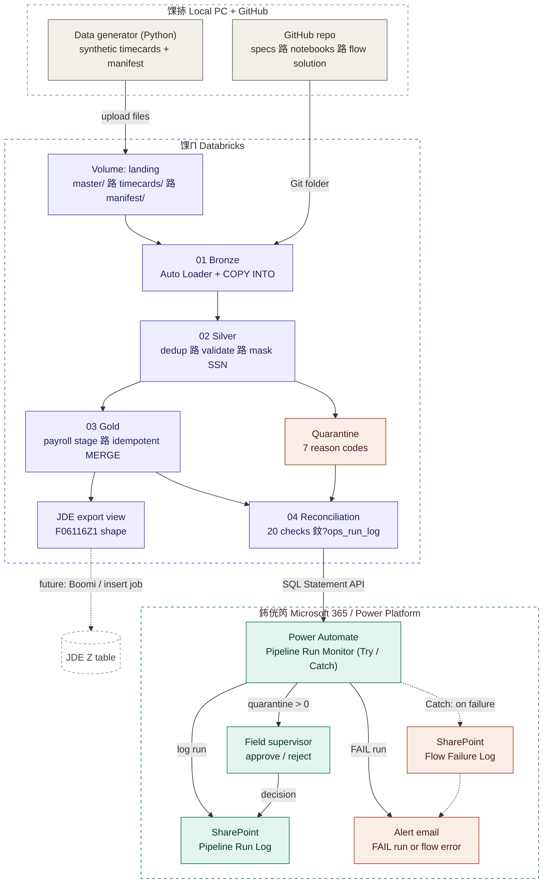

# applications-engineer-lab
Practice lab built while preparing for an Applications Engineer role — timecard-to-payroll integration with Databricks, data validation, and JDE staging.

## Purpose

This is a practice lab for an Applications Engineer role at a utility contractor. The role covers integrations, data validation, and payroll staging. The lab models a fictional Northern California contractor whose field crews do gas distribution, electric underground, airport fueling, and telecom work. Foremen log daily crew time in a HeavyJob-style timecard system against each job's cost codes. Approved time then flows through staging into JD Edwards payroll. Everything runs on synthetic data only.

## Synthetic-data notice

All names, jobs, and SSNs are generated. SSNs use the never-issued 900-999 area range, so they can't belong to a real person. Silver masks SSN to the last 4 digits, and gold carries no SSN. The clients (Ridgeline Gas & Electric, Valley Regional Airport, Harborview Fiber) and every job are invented.

## Architecture

```
data/generator (Python, seeded)
   |  CSV master data + NDJSON timecards + manifest.json
   v
Unity Catalog Volume  /Volumes/workspace/ae_lab/landing
   |  01_bronze_ingest: Auto Loader (timecards), COPY INTO (master)
   v
bronze  (raw, with lineage columns)
   |  02_silver_validate: dedup, typing, SSN masking, validation rules
   v
silver  ---->  silver_timecard_quarantine (lines that fail a rule, with dq_reasons)
   |  03_gold_payroll: MERGE with row hash
   v
gold_payroll_stage
   |
   v
vw_f06116z1_export  (JDE timecard staging view)
   |
   v
(planned) Power Automate flows
```

`04_reconciliation` checks every layer against the generator's `manifest.json` and logs each run to `ops_run_log`.





## Role mapping

| Lab component | Skill demonstrated | Status |
|---|---|---|
| Auto Loader + COPY INTO bronze | Databricks integrations, data staging, file-based transfers | Built |
| Silver validation + quarantine | Data validation, master data management | Built |
| SSN masking in silver | Ethical handling of payroll / PII | Built |
| MERGE into gold with row hash | Idempotent integrations, SQL | Built |
| `vw_f06116z1_export` | JD Edwards payroll integration | Built |
| `04_reconciliation` + `ops_run_log` | Troubleshooting, root cause analysis | Built |
| Power Automate flows | Build and maintain Power Automate flows | Planned |
| Solution unpacked to Git | Version control, code review | Planned |
| UAT plan | User Acceptance Testing | Planned |

## Run it

Set up a venv and generate the data (Python 3.11+):

```
python -m venv .venv
.venv\Scripts\activate          # macOS/Linux: source .venv/bin/activate
pip install -r requirements.txt
python data/generator/generate.py --seed 42 --start-date 2026-11-02 --workdays 10 --out data/output
pytest -q data/generator/tests
```

The generator wipes and rewrites `data/output/` on every run. The output is byte-deterministic for a given seed and is committed to the repo.

Upload the output to Databricks: **Catalog** → `workspace` → `ae_lab` → **Volumes** → `landing` → **Upload to this volume**. Upload into the folders `master/`, `timecards/`, and `manifest/`. Then run notebooks `01` through `04` in order.

The seeded defects (duplicates, superseded revisions, bad jobs, unknown employees, invalid cost codes, negative hours, over-24-hour days, unapproved cards) and their expected line counts are listed in `data/output/manifest/manifest.json`. The full contract is in [specs/SPEC-01-scaffold-and-generator.md](specs/SPEC-01-scaffold-and-generator.md).
